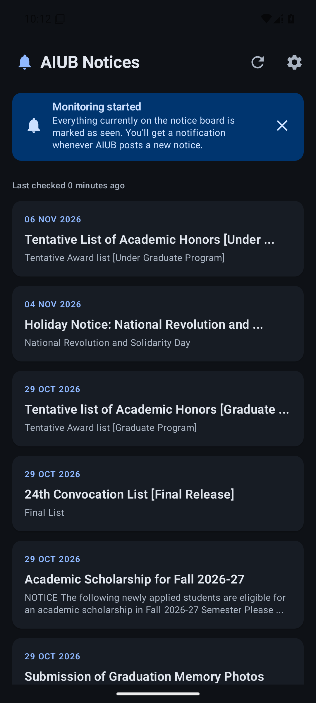
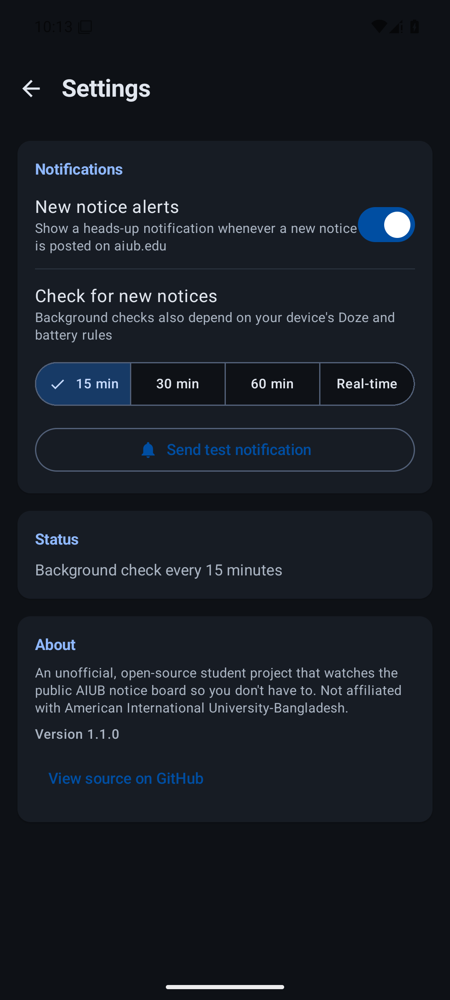
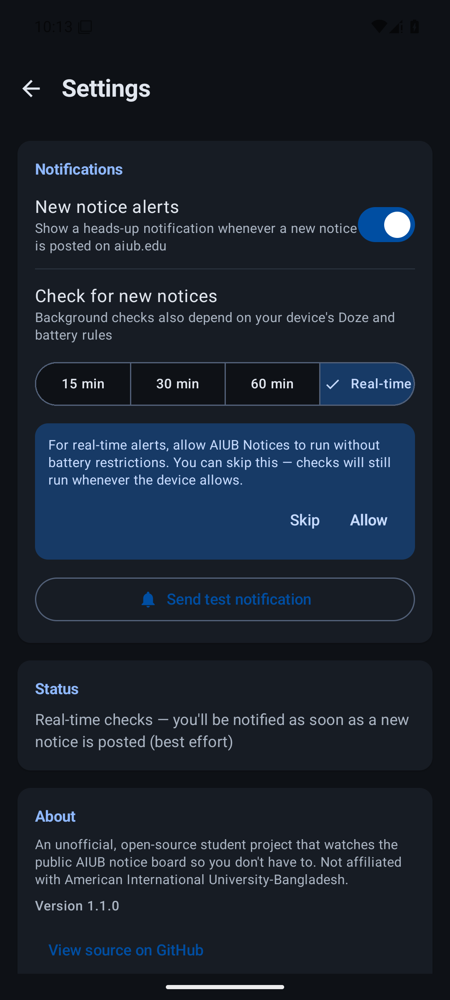
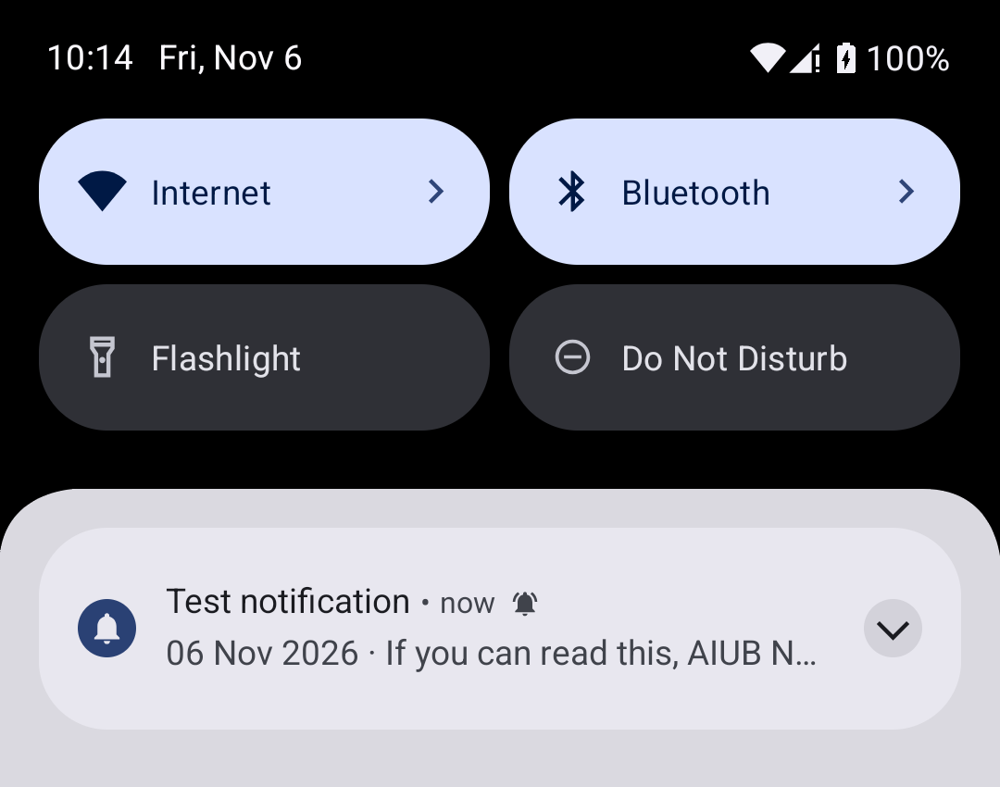
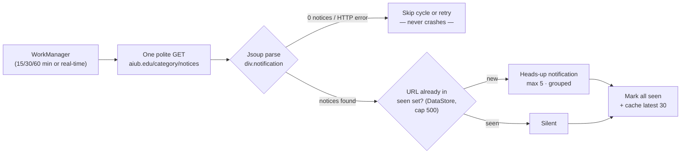

<div align="center">

# 📢 AIUB Notices

**A native Android app that watches the official AIUB notice board — and taps you on the shoulder the moment something new is posted.**

No login · No backend · No tracking · Fully offline-capable

[](https://github.com/Shishir-ip/AIUB-Notices/actions/workflows/android-ci.yml)
[](https://github.com/Shishir-ip/AIUB-Notices/releases)
[](LICENSE)


| Notices — live from aiub.edu | Settings | Real-time mode | Heads-up notification |
|:---:|:---:|:---:|:---:|
|  |  |  |  |

</div>

---

## Why

[AIUB](https://www.aiub.edu) publishes every official announcement — exam schedules, fee deadlines, results, events — on its [public notice board](https://www.aiub.edu/category/notices). But there is no way to *know* when something new appears: you have to keep re-checking the page yourself.

**AIUB Notices** fixes that with zero accounts, zero servers and zero tracking. It runs entirely on your phone.

## ✨ Features

- 🔔 **Heads-up notifications** for every new notice — max 5 per poll, grouped under one summary when several arrive together
- ⚡ **Real-time mode** — checks roughly once a minute so notifications land as fast as the device allows
- 🗓️ **Background polling** every 15/30/60 minutes via WorkManager — even when the app is closed
- 📰 **Offline notice list** — the latest 30 notices are cached locally, so the app is useful in airplane mode
- 🌐 **One-tap open** — notifications and list items launch the official notice page in your browser
- 🚀 **Manual refresh** button + pull-to-refresh
- 🧪 **Test notification** button to verify everything end-to-end
- 🛡️ **Never crashes on site changes** — HTTP errors and layout changes just skip a cycle
- 🎨 **Material 3 dark UI** with the AIUB blue (`#004EA2`) accent and a bell app icon

## 🔍 How it works

The notice board is **plain server-rendered HTML** — no JavaScript, no API keys. One poll cycle:



**Scraping.** Each notice on the page is an anchor wrapping a `div.notification` card:

```html
<a href="/notice-slug">
  <div class="notification">
    <div class="date-custom ...">04 Nov <span>2026</span></div>
    <div class="notification-text">
      <h2 class="title">Notice title here ...</h2>
      <p class="desc">Short description</p>
      <a class="info-link" href="/notice-slug">Details</a>
    </div>
  </div>
</a>
```

- **Title** → `selectFirst("h2.title")`, **description** → `p.desc`
- **Date** → `.date-custom` text (`"04 Nov 2026"`); the year comes from the inner `<span>`, falling back to the current year when missing
- **URL** → the closest ancestor `a[href]`, with fallbacks to the anchors inside the card (the HTML5 parser restructures nested anchors via the *adoption agency algorithm*, so the wrapper may not survive as an ancestor) — resolved against `https://www.aiub.edu`
- Jsoup's `.text()` unescapes HTML entities (`&amp;` → `&`) automatically

**Notification logic.**

- The first launch records everything currently on the board as seen **silently** (the baseline) and shows the *"Monitoring started"* banner — after that you only hear about genuinely new notices.
- New notices → channel `aiub_notices` (importance HIGH, heads-up), `date · description` as text, tap opens the notice URL via a `FLAG_IMMUTABLE` PendingIntent, grouped behind a summary when several arrive in one cycle.

**Scheduling.**

- *15/30/60 min* → a unique `PeriodicWorkRequest` with a CONNECTED constraint and exponential backoff.
- *Real-time* → WorkManager's periodic floor is 15 minutes, so this mode runs a **self-rescheduling chain** of one-time checks (~1 min apart). The chain re-reads settings on every run and stops by itself when you switch modes; pending enqueues are deduplicated so schedules can never pile up. When you pick real-time, Settings shows one small **skippable** banner offering the one-tap system dialog to remove battery restrictions — skipping just hides the prompt.
- All work is non-expedited: Android may defer checks under Doze/battery saver (notifications can arrive late — accepted by design).
- Manual "Refresh now" + pull-to-refresh always work when the app is open (and are silent — you're already looking at the list).

## 🧱 Built with

| Concern | Choice |
|---|---|
| Language | Kotlin · minSdk 26 · target/compileSdk 35 |
| UI | Jetpack Compose + Material 3 (dark by default, AIUB blue accent) |
| HTML parsing | [Jsoup](https://jsoup.org) — unit-tested against a saved fixture of the real page |
| Background work | [WorkManager](https://developer.android.com/topic/libraries/architecture/workmanager) — periodic or real-time chain |
| Persistence | [DataStore Preferences](https://developer.android.com/topic/libraries/architecture/datastore) — seen-set, cache, settings |

**Permissions:** `INTERNET` and `POST_NOTIFICATIONS`, plus `REQUEST_IGNORE_BATTERY_OPTIMIZATIONS` (optional — only used to show the system battery dialog for real-time mode; you can always decline or skip). No backend, no accounts, no analytics.

<details>
<summary><strong>📁 Project structure</strong></summary>

```
app/src/main/java/io/github/shishirip/aiubnotices/
├── AiubNoticesApp.kt          # Application: creates the notification channel
├── MainActivity.kt            # Single activity + POST_NOTIFICATIONS request
├── data/
│   ├── Notice.kt              # Notice model
│   ├── NoticeParser.kt        # Jsoup parsing (unit-tested against a fixture)
│   ├── NoticeRepository.kt    # One HTTP request + sync/diff logic
│   └── NoticeStore.kt         # DataStore: seen set, cache, settings
├── notify/
│   └── Notifier.kt            # Channel, grouped notifications, test notification
├── work/
│   ├── NoticePollWorker.kt    # CoroutineWorker: one poll cycle
│   └── PollScheduler.kt       # Periodic schedule + real-time chain
└── ui/
    ├── AiubNoticesApp.kt      # Scaffold + screen switching
    ├── NoticesScreen.kt       # List, pull-to-refresh, banners
    ├── SettingsScreen.kt      # Toggle, interval, real-time, test button
    ├── AppViewModel.kt        # UiState + baseline + refresh
    └── theme/Theme.kt         # Material 3 dark theme, AIUB blue
```

</details>

## 🚀 Get the app

**Easiest:** download the signed APK from the [latest release](https://github.com/Shishir-ip/AIUB-Notices/releases) and install it on any Android 8.0+ phone.

**Build from source** (requires the Android SDK 35 and JDK 17+):

```bash
git clone https://github.com/Shishir-ip/AIUB-Notices.git
cd AIUB-Notices
./gradlew assembleDebug        # debug APK → app/build/outputs/apk/debug/
./gradlew testDebugUnitTest    # parser tests
```

Then open the project in Android Studio and press ▶, or:

```bash
adb install app/build/outputs/apk/debug/app-debug.apk
```

### 🔐 Release signing

The repository intentionally does **not** contain the release keystore. To build a signed release:

1. Generate a keystore (once):

   ```bash
   keytool -genkeypair -v \
     -keystore keystore/aiub-notices.jks \
     -alias aiub-notices -keyalg RSA -keysize 4096 -validity 10950
   ```

2. Create `keystore/keystore.properties` (gitignored):

   ```properties
   storeFile=aiub-notices.jks
   storePassword=YOUR_STORE_PASSWORD
   keyAlias=aiub-notices
   keyPassword=YOUR_KEY_PASSWORD
   ```

3. Build: `./gradlew assembleRelease` → `app/build/outputs/apk/release/app-release.apk`

> 🔐 **Keep `keystore/` safe and backed up** — losing it means you can never update the app in place. If no keystore is present, `assembleRelease` falls back to the debug key so CI never breaks.

## ✅ Manual test checklist

1. **Install & baseline** — install the app and grant the notification permission on first launch. The app fetches the board, marks everything currently on it as seen *silently*, and shows the blue **"Monitoring started"** banner. No notifications yet.
2. **Poll finds nothing new** — tap refresh, or wait for a background cycle. The list refreshes; no notifications appear (everything is already seen).
3. **New notice → notification** — when AIUB posts a new notice (or test by clearing app data: Settings → Apps → AIUB Notices → Storage → Clear data, then wait for a poll): a heads-up notification appears with the notice title and `date · description`. Tapping it opens the notice in the browser.
4. **Grouping** — with several unseen notices, at most 5 child notifications appear under one summary ("N new AIUB notices").
5. **Test notification** — Settings → *Send test notification* posts a sample instantly.
6. **Real-time mode** — Settings → pick *Real-time*: an immediate check runs, then roughly one per minute. The battery prompt appears once — *Allow* is recommended for reliability; *Skip* hides it. Switching back to 15/30/60 min stops the chain automatically.
7. **Offline behavior** — enable airplane mode and refresh: an error banner appears, the cached list stays usable, the app does not crash. Background polls retry with backoff.
8. **Interval change** — pick 30 or 60 min; WorkManager reschedules (`adb shell dumpsys jobscheduler | grep aiub` shows the updated job).

## ⚖️ License & disclaimer

[MIT](LICENSE) © Shohidul Islam

This is an **unofficial, open-source student project** — not affiliated with or endorsed by American International University-Bangladesh (AIUB). It only reads the public notice board, politely: exactly one request per poll with a custom User-Agent (`AIUBNoticesApp/1.0 (student project)`).
